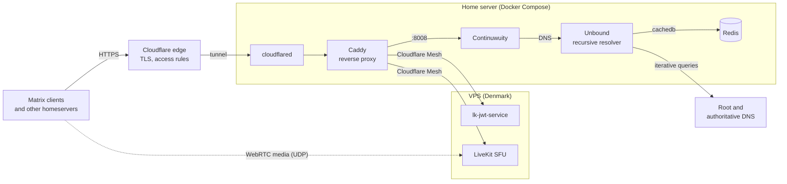

# Self-hosted Matrix homeserver (Continuwuity)

A federated [Matrix](https://matrix.org) chat server with voice and video calls (MatrixRTC), running on a home Linux server with Docker Compose. It is publicly reachable at **salo-ua.com** without any router port forwarding.

It is part of my homelab, a headless openSUSE Tumbleweed server administered over SSH, and was built as a hands-on learning project in Linux, containers, networking and DNS.

## What it does

- **Matrix homeserver:** [Continuwuity](https://continuwuity.org), a lightweight Rust homeserver with an embedded RocksDB database, so no separate PostgreSQL is needed.
- **Federation:** users on `salo-ua.com` can talk to users on any other Matrix server, such as matrix.org.
- **Voice and video calls:** MatrixRTC through a [LiveKit](https://livekit.io) SFU on a separate VPS, advertised to clients through `.well-known`.
- **Own recursive DNS:** federation relies on many DNS lookups (SRV records, `.well-known`, server keys). The homeserver resolves them through its own DNSSEC-validating Unbound resolver, which talks to the root servers directly and caches answers in Redis. No third-party DNS forwarder is involved.
- **Exposed only through Cloudflare Tunnel:** `cloudflared` opens an outbound-only connection to Cloudflare, so the home network needs no port forwarding and the home IP stays hidden.

## Architecture



### Request flow

1. Clients and federating servers connect to `matrix.salo-ua.com` (or `salo-ua.com/.well-known/matrix/*`) over HTTPS. TLS ends at Cloudflare's edge.
2. The request travels through the Cloudflare Tunnel to `cloudflared`, which passes it to Caddy on the internal Docker network.
3. Caddy routes by hostname:
   - `matrix.salo-ua.com` goes to Continuwuity on port 8008.
   - `salo-ua.com/.well-known/matrix*` goes to Continuwuity, which serves the delegation file telling other servers and clients to use `matrix.salo-ua.com:443`.
   - `livekit.salo-ua.com` goes across Cloudflare Mesh to the VPS. Token requests (`/sfu/get`, `/get_token`, `/healthz`) go to `lk-jwt-service`, and everything else goes to the LiveKit server.
4. Call media (WebRTC) flows directly between clients and the LiveKit SFU on the VPS, which has the open ports that media needs.
5. When Continuwuity needs to resolve another homeserver, it queries Unbound at a fixed internal IP (`10.10.10.20`) through a custom `resolv.conf`. Unbound validates the answers with DNSSEC and caches them in Redis, so the cache survives container restarts.

## Components

| Service | Image | Role |
|---|---|---|
| `matrix` | `continuwuation/continuwuity` | Matrix homeserver: client and federation APIs, `.well-known`, MatrixRTC focus advertisement |
| `caddy` | `caddy:2.11.4` | Hostname-based reverse proxy to Continuwuity and to LiveKit on the VPS |
| `cloudflared` | `cloudflare/cloudflared` | Outbound-only Cloudflare Tunnel; the only way in from the internet |
| `unbound` | `madnuttah/unbound` | DNSSEC-validating recursive resolver with a local copy of the root zone (RFC 8806) |
| `redis` | `redis:alpine` | Persistent cache backend for Unbound (`cachedb` module), password-protected and LRU-evicting |

On the VPS (configuration in [`livekit/`](livekit/)): the LiveKit SFU and `lk-jwt-service`, which issues LiveKit tokens to Matrix users.

## Design decisions

- **Cloudflare Tunnel instead of port forwarding.** Nothing has to be opened on the home router, and Cloudflare access rules (including geo-restrictions for the rest of the homelab) apply in front of the server. The Matrix hostnames have their own rule exceptions so that federation traffic from other countries is not blocked.
- **LiveKit on a separate VPS.** WebRTC media needs a range of open UDP ports, which a tunnel can't provide. A small VPS handles media, while signalling still goes through the home server's Caddy. The two machines are connected privately over Cloudflare Mesh.
- **Own resolver instead of Docker's DNS.** Federation produces a lot of DNS traffic. A dedicated recursive resolver avoids depending on, and leaking queries to, a public DNS provider, and adds DNSSEC validation. Continuwuity's internal DNS cache is disabled (`CONTINUWUITY_DNS_CACHE_ENTRIES=0`) so that caching happens in one place.
- **Redis as Unbound's cache backend.** It keeps the DNS cache across restarts instead of starting cold each time.
- **Fixed subnet and IP for Unbound.** `resolv.conf` needs an IP address rather than a hostname, so the `unbound_resolver` network uses a static subnet (`10.10.10.0/24`).
- **Health-ordered startup.** `depends_on` with `service_healthy` brings things up in order: Redis, then Unbound, then Continuwuity. That way the homeserver never starts without working DNS.

## Repository layout

```
.
├── compose.yaml               # all services, volumes, network
├── Caddyfile                  # reverse-proxy routes
├── unbound.conf               # recursive resolver + Redis cachedb
├── redis.conf                 # Redis config (password, eviction)
├── matrix-resolv.conf         # points Continuwuity at Unbound
├── cloudflared.env.example    # template for the tunnel token (real file is git-ignored)
├── livekit/                   # VPS side, deployed separately
│   ├── compose.yaml           # LiveKit SFU + lk-jwt-service
│   └── livekit.yaml           # LiveKit server config (ports, API keys)
└── .gitignore                 # keeps real secrets out of Git
```

## Deploying your own

Prerequisites: a Linux host with Docker and Docker Compose, a domain managed in Cloudflare, and (for calls) a VPS for LiveKit (see step 6).

1. **Create a Cloudflare Tunnel** in Zero Trust → Networks → Tunnels. Add public hostnames for `matrix.<domain>`, `<domain>` and `livekit.<domain>`, all pointing at the Caddy container (`http://matrix-caddy:80`).
2. **Add the tunnel token:**
   ```bash
   cp cloudflared.env.example cloudflared.env
   # edit cloudflared.env and paste your tunnel token
   ```
3. **Set a Redis password.** Choose a strong one and put it in both `redis.conf` (`requirepass`) and `unbound.conf` (`redis-server-password`).
4. **Replace the domain** `salo-ua.com` in `compose.yaml` and `Caddyfile` with your own. Replace `<VPS_MESH_IP>` in `Caddyfile` with your VPS's Cloudflare Mesh address.
5. **Start the stack:**
   ```bash
   docker compose up -d
   docker compose ps      # wait until unbound and redis report healthy
   ```
6. **Set up LiveKit on the VPS** (optional, for calls). Copy `livekit/` to the VPS, then:
   ```bash
   docker run --rm livekit/livekit-server generate-keys
   ```
   Put the generated pair in `livekit.yaml` (`keys:`) and in `compose.yaml` (`LIVEKIT_KEY`, `LIVEKIT_SECRET`), replace `<VPS_MESH_IP>` and the domain, and run `docker compose up -d`. Open 7881/tcp and 50100–50200/udp on the VPS firewall for media.
7. **Check federation** with the [Matrix Federation Tester](https://federationtester.matrix.org/).

The Continuwuity admin console is enabled. Reach it with `docker attach <matrix container>` and detach with `Ctrl-P Ctrl-Q`.

## Security notes

- No secrets are committed: the tunnel token lives in a git-ignored `cloudflared.env`, and the passwords and LiveKit API keys in this repo are placeholders.
- Unbound and Redis are reachable only on the internal Docker network and are never published to the host.
- Unbound hides its identity and version, refuses `ANY` queries, and hardens against DNSSEC stripping and cache poisoning (`harden-*`, `qname-minimisation`, `aggressive-nsec`).
- No ports are published on the home server at all: the only way in is the outbound Cloudflare Tunnel, and the home IP address isn't published in DNS.
- On the VPS, `lk-jwt-service` is published only on the Cloudflare Mesh address, so it can't be reached from the VPS's public IP. LiveKit runs with host networking because WebRTC media needs its UDP port range open to the internet.

## Roadmap

- Export Continuwuity metrics to the homelab's existing Prometheus + Grafana monitoring
- Centralised logs with Grafana Alloy + Loki

