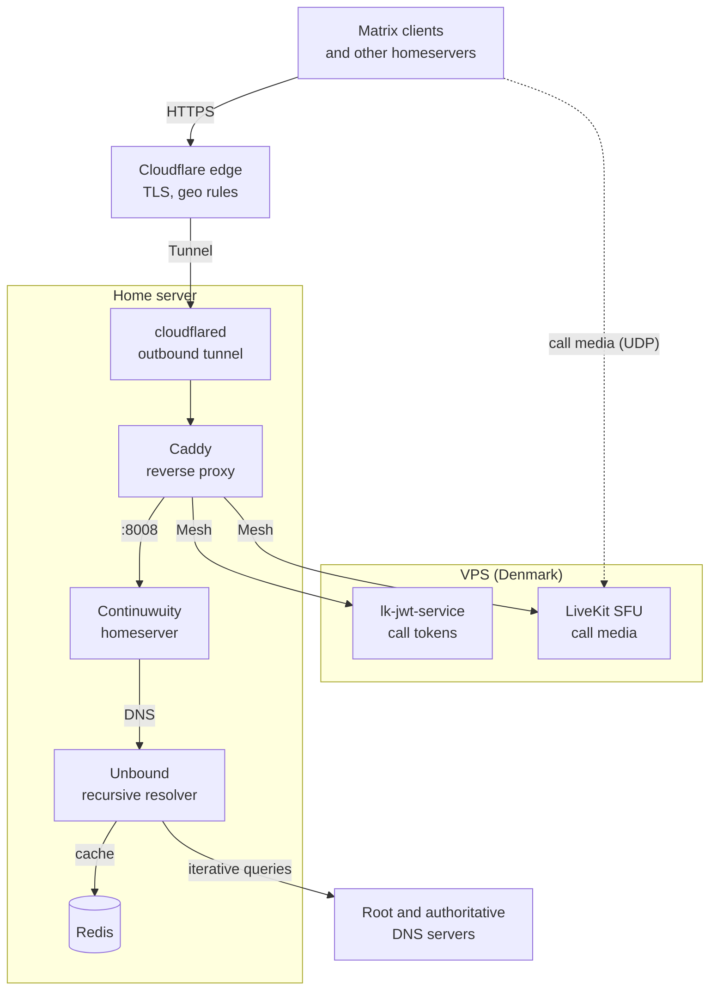
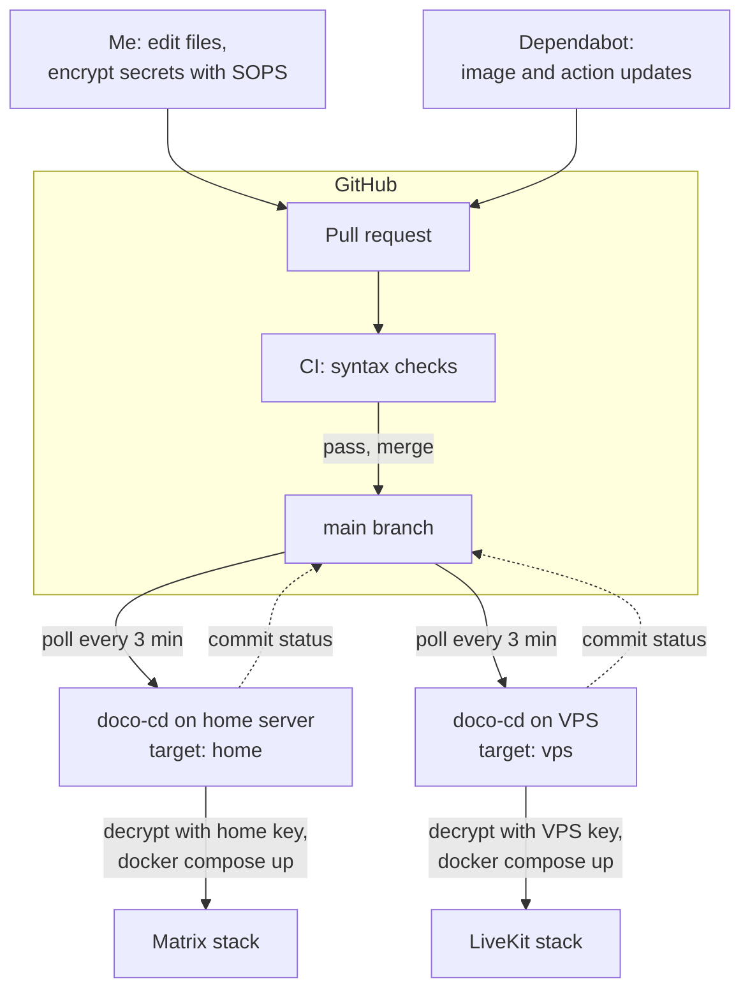

# Self-hosted Matrix homeserver (Continuwuity)

A federated [Matrix](https://matrix.org) chat server with voice and video calls (MatrixRTC), running on a home Linux server with Docker Compose. It is publicly reachable at **salo-ua.com** without any router port forwarding.

It is part of my homelab, a headless openSUSE Tumbleweed server administered over SSH, and was built as a hands-on learning project in Linux, containers, networking, DNS and GitOps. Both servers are deployed from this repository: a merged pull request is rolled out automatically by [doco-cd](https://github.com/kimdre/doco-cd), with secrets committed in encrypted form using [SOPS](https://getsops.io) and [age](https://age-encryption.org).

## What it does

- **Matrix homeserver:** [Continuwuity](https://continuwuity.org), a lightweight Rust homeserver with an embedded RocksDB database, so no separate PostgreSQL is needed.
- **Federation:** users on `salo-ua.com` can talk to users on any other Matrix server, such as matrix.org.
- **Voice and video calls:** MatrixRTC through a [LiveKit](https://livekit.io) SFU on a separate VPS, advertised to clients through `.well-known`.
- **Own recursive DNS:** federation relies on many DNS lookups (SRV records, `.well-known`, server keys). The homeserver resolves them through its own DNSSEC-validating Unbound resolver, which talks to the root servers directly and caches answers in Redis. No third-party DNS forwarder is involved.
- **Exposed only through Cloudflare Tunnel:** `cloudflared` opens an outbound-only connection to Cloudflare, so the home network needs no port forwarding and the home IP stays hidden.
- **GitOps deployment:** pull requests are checked by CI, Dependabot keeps image versions up to date, and doco-cd on each server deploys what is on `main` and reports the result back to GitHub as a commit status.

## Architecture



### Request flow

1. Clients and federating servers connect to `matrix.salo-ua.com` (or `salo-ua.com/.well-known/matrix/*`) over HTTPS. TLS ends at Cloudflare's edge.
2. The request travels through the Cloudflare Tunnel to `cloudflared`, which passes it to Caddy on the internal Docker network.
3. Caddy routes by hostname:
   - `matrix.salo-ua.com` goes to Continuwuity on port 8008.
   - `salo-ua.com/.well-known/matrix*` goes to Continuwuity, which serves the delegation file telling other servers and clients to use `matrix.salo-ua.com:443`.
   - `livekit.salo-ua.com` goes across Cloudflare Mesh to the VPS. Token requests (`/sfu/get`, `/get_token`, `/healthz`) go to `lk-jwt-service`, and everything else, including the call's WebSocket on `/rtc`, goes to the LiveKit server.
4. Call media (WebRTC) flows directly between clients and the LiveKit SFU on the VPS, which has the open ports that media needs. Only call setup (signalling) passes through Cloudflare.
5. When Continuwuity needs to resolve another homeserver, it queries Unbound at a fixed internal IP (`10.10.10.20`) through a custom `resolv.conf`. Unbound validates the answers with DNSSEC and caches them in Redis, so the cache survives container restarts.

## Components

| Service | Image | Role |
|---|---|---|
| `matrix` | `jadedblueeyes/continuwuity` | Matrix homeserver: client and federation APIs, `.well-known`, MatrixRTC focus advertisement |
| `caddy` | `caddy` | Hostname-based reverse proxy to Continuwuity and to LiveKit on the VPS |
| `cloudflared` | `cloudflare/cloudflared` | Outbound-only Cloudflare Tunnel; the only way in from the internet |
| `unbound` | `madnuttah/unbound` | DNSSEC-validating recursive resolver with a local copy of the root zone (RFC 8806) |
| `redis` | `redis` (Alpine) | Persistent cache backend for Unbound (`cachedb` module), password-protected and LRU-evicting |

On the VPS (configuration in [`livekit/`](livekit/)): the LiveKit SFU and `lk-jwt-service`, which issues LiveKit tokens to Matrix users.

Every image is pinned to an exact version in the compose files, and Dependabot opens a pull request when a new one is released.

## Deployment (GitOps)



### How a change reaches the servers

1. **Every change is a pull request.** `main` is protected by a ruleset: changes go through a pull request, and the `syntax_check` workflow must pass first.
2. **CI** ([`.github/workflows/syntax-check.yml`](.github/workflows/syntax-check.yml)) validates both compose files with `docker compose config` and the Caddyfile with `caddy validate`, using the Caddy version from `compose.yaml`. The real secrets are never available in CI, so the workflow supplies dummy values for every `${...}` variable.
3. **Dependabot** ([`.github/dependabot.yml`](.github/dependabot.yml)) checks weekly for new versions of the container images in both compose files and of the GitHub Actions used by CI.
4. **doco-cd runs on each server** and polls the repository every three minutes. Polling means no inbound connection or webhook endpoint is needed, which fits a server that is only reachable through a tunnel.
5. **Each server deploys only its own part.** Both doco-cd instances read the same repository, but each one has a different *target* in its poll configuration, which selects a deploy config file:

   | Server | Poll config | Reads | Deploys |
   |---|---|---|---|
   | Home | `target: home` | [`.doco-cd.home.yml`](.doco-cd.home.yml) | the repository root (`compose.yaml`) |
   | VPS | `target: vps` | [`.doco-cd.vps.yml`](.doco-cd.vps.yml) | `livekit/` |

6. **doco-cd decrypts and deploys.** It downloads the commit, decrypts every SOPS file it holds a key for, and runs `docker compose up -d` under the existing project name, so the named volumes (including the Matrix database) are reattached unchanged. Only services whose configuration changed are recreated.
7. **The result is reported back to GitHub** as a commit status (`doco-cd/home/unbound`, `doco-cd/vps/livekit`), with progress stages and a final ✓ or ✗ next to the merge commit.

### Secrets

Secrets are committed to the repository **encrypted with SOPS and age**, so the full configuration lives in Git without exposing anything. [`.sops.yaml`](.sops.yaml) decides which keys each file is encrypted to:

| File | Contents | Can be decrypted by |
|---|---|---|
| [`secrets.enc.env`](secrets.enc.env) | tunnel token, Redis password, VPS Mesh IP | home server, my workstation |
| [`unbound-cachedb.enc.conf`](unbound-cachedb.enc.conf) | Unbound's Redis connection settings (incl. password) | home server, my workstation |
| [`livekit/secrets.enc.env`](livekit/secrets.enc.env) | LiveKit API key and secret, VPS Mesh IP | VPS, my workstation |

- Each server has its own age key, stored only on that server. **The VPS cannot read the home server's secrets, and vice versa.** My workstation's key is a recipient of every file, so I can edit them with `sops edit`.
- The values reach the services in two ways: as Compose variables (`${TUNNEL_TOKEN:?missing}` etc., loaded through `env_files` in the deploy config), and, for Unbound, which cannot read environment variables, as a whole encrypted config file that `unbound.conf` pulls in with `include:`.
- `:?missing` makes Compose refuse to deploy if a value is absent, for example because decryption failed. The running containers are then left untouched, instead of being restarted with empty secrets.
- Templates showing which values exist: [`secrets.env.example`](secrets.env.example), [`unbound-cachedb.conf.example`](unbound-cachedb.conf.example), [`livekit/secrets.env.example`](livekit/secrets.env.example).

### doco-cd itself

doco-cd's own compose file lives on each server, outside this repository, together with its GitHub token and the server's age key. It is updated by hand. Notable settings:

- `POLL_CONFIG` with the repository URL and the server's `target`
- `SOPS_AGE_KEY_FILE`, pointing to the age key, which is mounted as a Docker secret (`root:root`, mode `600`)
- `GIT_COMMIT_STATUS: "true"` and a fine-grained token limited to this repository (Contents: read, Commit statuses: read and write)
- `GIT_AUTH_DOMAINS`, which restricts the token to `github.com`
- `cap_drop: ALL`, and its own bridge network (`br-doco-cd`) so that it can be allowed explicitly in the firewall

## Design decisions

- **Cloudflare Tunnel instead of port forwarding.** Nothing has to be opened on the home router, and Cloudflare access rules (including geo-restrictions for the rest of the homelab) apply in front of the server. The Matrix hostnames have rule exceptions so that federation traffic from other countries is not blocked, and so does `livekit.salo-ua.com`: calls can include users from anywhere, and every LiveKit endpoint already requires a token issued for a Matrix login.
- **LiveKit on a separate VPS.** WebRTC media needs a range of open UDP ports, which a tunnel can't provide. A small VPS handles media, while signalling still goes through the home server's Caddy. The two machines are connected privately over Cloudflare Mesh.
- **Own resolver instead of Docker's DNS.** Federation produces a lot of DNS traffic. A dedicated recursive resolver avoids depending on, and leaking queries to, a public DNS provider, and adds DNSSEC validation. Continuwuity's internal DNS cache is disabled (`CONTINUWUITY_DNS_CACHE_ENTRIES=0`) so that caching happens in one place.
- **Redis as Unbound's cache backend.** It keeps the DNS cache across restarts instead of starting cold each time.
- **Fixed subnet and IP for Unbound.** `resolv.conf` needs an IP address rather than a hostname, so the `unbound_resolver` network uses a static subnet (`10.10.10.0/24`).
- **Health-ordered startup.** `depends_on` with `service_healthy` brings things up in order whenever Compose starts the stack, as on every deploy: Redis, then Unbound, then Continuwuity. That way the homeserver never starts without working DNS. After a host reboot, Docker's restart policy brings the containers back without this ordering.
- **Pull-based deployment (doco-cd) instead of CI pushing to the servers.** The servers fetch their configuration themselves, so GitHub needs no SSH access or credentials for them, and no self-hosted runner has to be exposed to a public repository.
- **Encrypted secrets in Git instead of GitHub Secrets.** GitHub Secrets are only available inside Actions runs, which a pull-based deployment never uses. With SOPS, every change, including a secret rotation, is a reviewed commit, and only the servers hold the keys to read it.
- **One repository, two targets.** Both servers share one repository and one history, while targets and separate keys keep each server limited to its own stack.

## Repository layout

```
.
├── compose.yaml                   # home stack: all services, volumes, network
├── Caddyfile                      # reverse-proxy routes ({$VPS_MESH_IP} from the environment)
├── unbound.conf                   # recursive resolver; includes the encrypted cachedb settings
├── redis.conf                     # Redis config (eviction etc.; password set on the command line)
├── matrix-resolv.conf             # points Continuwuity at Unbound
├── secrets.enc.env                # home secrets, SOPS-encrypted
├── secrets.env.example            # template for secrets.enc.env
├── unbound-cachedb.enc.conf       # Unbound's Redis settings, SOPS-encrypted
├── unbound-cachedb.conf.example   # template for unbound-cachedb.enc.conf
├── livekit/                       # VPS stack
│   ├── compose.yaml               # LiveKit SFU + lk-jwt-service
│   ├── livekit.yaml               # LiveKit server config (ports, interfaces)
│   ├── secrets.enc.env            # LiveKit secrets, SOPS-encrypted
│   └── secrets.env.example        # template for secrets.enc.env
├── .doco-cd.home.yml              # what doco-cd deploys on the home server
├── .doco-cd.vps.yml               # what doco-cd deploys on the VPS
├── .sops.yaml                     # which age keys each encrypted file is for
├── .github/
│   ├── workflows/syntax-check.yml # CI: compose and Caddyfile validation
│   └── dependabot.yml             # weekly image and action updates
└── .gitignore                     # keeps plain-text secrets out of Git
```

## Deploying your own

Prerequisites: a Linux host with Docker and Docker Compose, a domain managed in Cloudflare, and (for calls) a VPS for LiveKit. On your workstation: `git`, [`sops`](https://getsops.io) and [`age`](https://age-encryption.org).

1. **Fork the repository** and replace the domain `salo-ua.com` in `compose.yaml`, `Caddyfile` and `livekit/compose.yaml` with your own.
2. **Create a Cloudflare Tunnel** in Zero Trust → Networks → Tunnels. Add public hostnames for `matrix.<domain>`, `<domain>` and `livekit.<domain>`, all pointing at the Caddy container (`http://matrix-caddy:80`). If you use geo or WAF rules, exempt the Matrix and LiveKit hostnames (see Design decisions).
3. **Create age keys:** one on each server and one on your workstation (`age-keygen -o <file>`). Put the **public** keys into `.sops.yaml`.
4. **Create and encrypt the secrets** from the templates, in the repository root:
   ```bash
   cp secrets.env.example secrets.env                     # fill in
   cp unbound-cachedb.conf.example unbound-cachedb.conf   # fill in, same Redis password
   cp livekit/secrets.env.example livekit/secrets.env     # fill in
   sops encrypt secrets.env > secrets.enc.env
   sops encrypt unbound-cachedb.conf > unbound-cachedb.enc.conf
   sops encrypt livekit/secrets.env > livekit/secrets.enc.env
   rm secrets.env unbound-cachedb.conf livekit/secrets.env
   ```
   Generate the LiveKit key pair with `docker run --rm livekit/livekit-server generate-keys`.
5. **Run doco-cd on each server** with a poll configuration pointing at your fork, `target: home` or `target: vps`, the server's age key and a fine-grained GitHub token (see [doco-cd itself](#doco-cd-itself)). doco-cd then deploys the stacks. If you take over stacks that are already running, the `name` in `.doco-cd.*.yml` must match the existing Compose project name, or Compose creates new, empty volumes.
6. **Open the LiveKit media ports on the VPS:** 7881/tcp and 50100–50200/udp.
7. **Check federation** with the [Matrix Federation Tester](https://federationtester.matrix.org/).

The Continuwuity admin console is enabled. Reach it with `docker attach unbound-matrix-1` and detach with `Ctrl-P Ctrl-Q`.

## Security notes

- Secrets are only committed in encrypted form. Each server holds its own age key and can decrypt only its own stack; private keys never leave the machines they belong to.
- No ports are published on the home server at all: the only way in is the outbound Cloudflare Tunnel, and the home IP address isn't published in DNS. doco-cd polls GitHub, so it needs no inbound connection either.
- Unbound and Redis are reachable only on the internal Docker network and are never published to the host. The Redis password is passed on Redis's command line and kept out of `redis.conf`.
- Unbound hides its identity and version, refuses `ANY` queries, and hardens against DNSSEC stripping and cache poisoning (`harden-*`, `qname-minimisation`, `aggressive-nsec`).
- doco-cd has access to the Docker socket, which is equivalent to root on the host. Its exposure is kept small: no published ports, all Linux capabilities dropped, and a GitHub token limited to one repository, read access to its contents, commit statuses, and the `github.com` host.
- On the VPS, `lk-jwt-service` is published only on the Cloudflare Mesh address, so it can't be reached from the VPS's public IP. LiveKit runs with host networking because WebRTC media needs its UDP port range open to the internet.

## Roadmap

- Automated, encrypted database backups (systemd timer, `age`, `rclone` to Cloudflare R2)
- Export Continuwuity metrics to the homelab's existing Prometheus + Grafana monitoring
- Centralised logs with Grafana Alloy + Loki
